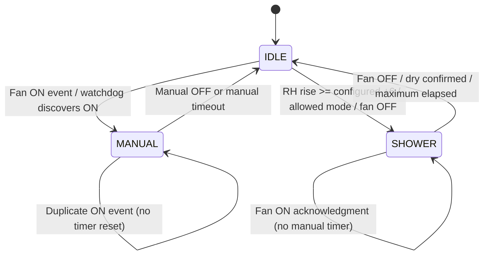

# FOXWARE FoxyFan v3.0.2 — Engineering Design

**Status:** v3.0.1 manual two-minute ON → timed OFF path observed live on Hubitat; v3.0.2 shower ON verification and notification changes still require live testing.

## Architecture decision: independent installed instances

Unlike an optional parent/child UI (which requires at least two Groovy sources), v3.0.0 uses **one reusable standalone Hubitat App** with `singleInstance: false`. An installation controls exactly one bathroom; install multiple copies of the same app code, each with its own persistent `state`, subscriptions, scheduled callbacks, selected devices, and preferences. `singleThreaded: true` serializes top-level callbacks **within each installed instance**, reducing the local event race that motivated replacement of the two webCoRE pistons. A separate deployment or duplicate device selection can still cause conflict: do not enable multiple controllers on the same fan.

## State machine

**IDLE:** no active ownership. `ffAwaitingOff` can temporarily inhibit new manual ownership after a command-off until the fan reports OFF.
**MANUAL:** `ffStartedAtMs` anchors the one-shot manual timeout, scheduled with a `ffGeneration` token; a one-minute watchdog provides missed-job recovery.
**SHOWER:** `ffShowerBase` and `ffStartedAtMs` anchor the humidity/duration logic. `ffDrySinceMs` is set only after the minimum runtime, and is cleared when humidity rises above the drying allowance.

Any state transition increments `ffGeneration` and invalidates stale manual timeout callbacks. The app updates ownership *before* invoking the device's `on()` or `off()` methods, preventing its own device events from being mistaken for external manual starts. A pending OFF acknowledgement suppresses re-arming based on stale ON device state.

## Trigger handling and data paths

**Humidity change event** → numeric RH validation (0–100) → record last actual change event → check IDLE, not pending OFF, eligible location mode, fan OFF → compare RH against oldest entry of minute-sampled history → transition to SHOWER before issuing `fanSwitch.on()`.

**Fan switch event** → OFF: cancel either active run and pending OFF acknowledgment → ON: if IDLE and not awaiting OFF, enter MANUAL; duplicate ON while already MANUAL does not restart the timer; ON while SHOWER is treated as a command acknowledgment.

**Minute watchdog** → reconcile OFF reports and active modes; apply manual deadline; apply automatic max/min/dry conditions; update rolling RH samples; optionally warn about missing change events or missing OFF acknowledgment.

**Manual timer callback** → require `MANUAL`, correct generation, non-early deadline and physical fan ON; then transition out of MANUAL and issue OFF. On old-generation callback, do nothing.

## Rolling humidity baseline

Build 20 stores six readings (`rh1m` through `rh6m`) updated once per minute, using the oldest as the shower baseline, approximately five minutes back. We generalize this to a configurable `historyMinutes + 1` list, stored in instance state. On first activation or a changed history window, fill the list with the currently reported value (matching Build 20's initialization behavior); then shift in a fresh `currentValue('humidity')` each minute. This means startup has an initially synthetic, constant baseline until actual history accrues; this is a known tradeoff inherited from B20 and should be tested in the first minutes after activation.

Comparison uses RH **points**, not a percentage of the original RH. For example, baseline 50%, trigger +6 points means RH at least 56%.

## Runtime and drying

- At shower detection: `ffShowerBase = oldest sample`, `ffStartedAtMs = now`, `ffDrySinceMs = null`, `ffMode = SHOWER`; then fan ON.
- Before minimum runtime: humidity does not cause an OFF.
- On/after minimum runtime: if the *current* RH ≤ `ffShowerBase + dryAllowance`, start (or continue) the dry confirmation clock. Otherwise, clear the confirmation clock.
- If the continuous dry interval reaches the configured duration: request OFF, log and optionally notify.
- The maximum runtime always takes **priority** and ends the run first on an exact-boundary overlap. This intentionally prevents Build 20's two independent IF blocks from sending two OFF commands/notifications on the same tick.
- Manual timer is armed when the fan is turned ON while not shower-owned; it is never reset by duplicate ON events.

## Device events, stale reporting, and OFF acknowledgments

Humidity sampling is event-driven for *shower starts* and minute-polled from the cached Hubitat attribute for the rolling baseline and dry completion, matching the practical nature of B20. It is **not** a guarantee of fresh radio reports. `ffLastHumidityEventMs` tracks only actual attribute-change events observed by this app. After the configurable age, a warning is logged once, not repeatedly. Drying decisions can still use the last Hubitat RH attribute, as in Build 20; a potentially frozen sensor can therefore lead to a premature dry decision if its value happens to be low, so make the sensor reporting frequency a deployment requirement. The maximum runtime protects against long fans, not every possible sensor failure.

For OFF commands, the app transitions to IDLE and sets `ffAwaitingOff` **before** dispatching `fanSwitch.off()`. It clears the pending flag when an OFF event arrives (or the minute watchdog sees `switch=off`), and warns if it remains pending 2 minutes later. It does not automatically re-start the manual timer from an old `switch=on` report. A stuck device may need manual attention; the app does not retry command-on or command-off indefinitely.

## Settings and UI

All thresholds and windows are integer inputs with ranges; device assignments use capabilities. Allowed modes are selected from the user's hub, rather than hardcoded. To match B20, select Home / Home-NoMotion / Home - Guest Mode. Blank allowed modes means **every mode**. This is a deliberate portability/default difference from the webCoRE hardcoding, documented prominently.

Push delivery uses selected `capability.notification` device(s), which implement `deviceNotification(text)`, instead of the webCoRE generic Push action. Logging is always local to the Hubitat app Logs; optional verbose diagnostics may be enabled.

## Startup / update behavior

`installed()` and `updated()` call `initialize()`, which removes subscriptions and scheduled jobs, restores persisted mode and timers, and creates one recurring one-minute job. If the app was disabled, no subscriptions or timer are active and the fan is **not touched**. If fan/sensor selection changes, old state is discarded without commanding either device. If the app starts with a fan already ON, it enters MANUAL and anchors the timer at discovery time; this should be avoided during cutover unless intentional.

Manual run persisted on restart is rearmed for its remaining duration. SHOWER run persisted on restart is evaluated by the minute watchdog against the original start; long downtime can make the maximum run trigger promptly upon resumption if the fan still reports ON.

## Differences versus exact B20 reference

| Topic | Build 20 | Native v3.0.0 draft |
|---|---|---|
| Installation | One hardcoded Master Bath piston | Multiple independent instances, user-selectable devices |
| Allowed modes | Hardcoded three Home modes | Optional selection; blank means all modes |
| Sensor baseline | Six one-minute slots | Configurable N+1 slots, initial seed matches B20 |
| Thresholds | +6 / +9 / 15 / 5 / 80 / 20 constants | Configurable with same numerical defaults |
| Timed manual OFF | Minute loop only, no `Wait` | Scheduled one-shot + minute watchdog; may end earlier than next minute boundary |
| Event races | Local ownsFan + once/minute mirror | Serialized callbacks + mode/generation guards and pending-OFF guard |
| Shower maximum | Independent IF; double-action possible at edge | One terminal outcome; max wins when simultaneous |
| Fan commands | `on/off` followed by `refresh` | `on/off` only, works with generic Switch capability |
| Push | Three webCoRE PUSH actions | Optional selected Notification devices; manual notification off by default |
| `@humidtrip` | Mirrored once per minute | Removed; no separate controlling piston remains |
| Humidity event age | Not monitored | Configurable informational warning |
| Startup safety | Live piston | `enableControl=false` until intentional cutover |

## Deferred scope / open engineering decisions

1. Automated Groovy unit tests against a Hubitat simulation and actual hub logging.
2. Optional parent/child management dashboard (nice but not necessary for separate installs).
3. Optional manual→SHOWER promotion on rapid RH rise while the fan is already ON — currently deliberately not implemented to mirror B20.
4. More robust sensor failure strategy: optional hold-to-maximum on stale RH, alternate humidity sensor, or device health integration.
5. More sophisticated operation state surfaced as a dedicated virtual device for Dashboard/Zabbix.
6. Automatic OFF command retry/acknowledgment policy with limited retry count.

## Security and safety

No network requests or external credentials. The app only controls the explicitly selected fan switch. It should never serve as life-safety ventilation. Keep the original piston exported and disabled for a quick rollback. Validate performance and device event delivery before production rollout.

## v3.0.1 post-OFF status reconciliation (live-test feedback)

v3.0.0 physically switched the fan OFF at manual timeout, but the Hubitat
`switch` attribute remained ON. v3.0.1 requests one *readback* 3 seconds
after a successful app-issued `fanSwitch.off()` when `postOffRefresh` is
true and the selected switch driver advertises `refresh`.

An `ffGeneration` token plus `IDLE`/`ffAwaitingOff` checks make that callback
stale-safe. The refresh is advisory: it **does not** fabricate an OFF event,
issue an additional OFF, or weaken the pre-existing pending-OFF interlock.
Drivers without `refresh()` continue with original v3.0.0 behavior and an
explicit warning. A full v3.0.1 manual two-minute test with device OFF reporting was subsequently observed on Hubitat on 2026-11-23.

## v3.0.2: ON readback and manual-event notifications

The native **OFF** handling was already centralized in `endRun` in v3.0.1,
so FoxFlatus completion, successful shower dry-down, and automatic maximum
runtime all share the same optional post-OFF refresh. This requires no second
OFF implementation. The humidity sensor's `RelativeHumidityMeasurement`
capability does not promise `refresh`, and a humidity-change event already
contains the new reading: v3.0.2 deliberately does NOT refresh the humidity
sensor for every event.

On `startShower`, FoxyFan commits SHOWER ownership, sets `ffAwaitingOn` and
records `ffOnRequestedAtMs` *before* calling `fanSwitch.on()`. If an ON switch
report arrives immediately, it clears the pending flag and no ON refresh is
needed. Otherwise, when `postOnRefresh` is enabled and the driver advertises
the `refresh()` command, an app callback requests a refresh approximately 3
seconds after the original request. A separate 20-second generation-protected
callback checks current reported switch state. While confirmation is pending,
OFF events and the minute watchdog are not allowed to treat cached OFF as
proof that the shower ended. If ON is still not reported, SHOWER ownership is
relinquished with a warning. **No additional ON/OFF command is sent:** when
readback fails, the user should inspect the physical fan. Confirmation is not
proof of physical motion, only the driver-reported `switch` attribute.

A source update during the pending-ON interval uses the original request
timestamp to schedule the remaining readback window. Pending callbacks have
state-generation guards and are unscheduled at run completion. The
ON-confirmation safeguard is an intentional enhancement over v3.0.1 and must
be tested with the Master Bath Fan driver before general deployment.

Three independent notification preferences are available for manual mode:
`notifyManualStart` (new, default OFF), `notifyManual` (existing timer
completion, unchanged key/default), and `notifyManualEarlyOff` (new, default
OFF). Early OFF can be recognized by the switch event or minute watchdog;
the same `endManualEarly()` routine prevents duplicate messages. None of
these notifications affects fan control if a notification device is unavailable.

## v3.0.4 — Native instance naming, notification identity and multiple bathrooms

Each native installed app instance already has independent state, subscriptions, and timers. All push messages use a single `sendNotice()` path. `notificationIdentity()` now avoids repeating the hardcoded product name when the default Hubitat app label equals that same name. Custom `app.label` values are preferred (with an already branded label kept as-is); the configured fan's `displayName` is the fallback for an unchanged default label. The last resort is the stable installed app ID.

The dynamic settings page also exposes Hubitat’s built-in `label` preference, allowing a user to name a specific installed app `Master Bathroom` or `Guest Bathroom`. It writes the `app.label` already consumed by `notificationIdentity()` and changes the displayed name in Hubitat’s Apps list. There is no redundant `customName` preference and no change to existing preference keys. This is presentation-only; notification device selection, per-event toggles, event handlers, and all fan control paths are unchanged. The displayed **Notification identity** line helps validate naming before adding a Guest Bathroom instance. Distinct fan devices remain a requirement for independent automation ownership.
